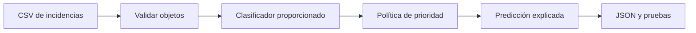

# Lab 1 · Clasificación y prioridad de incidencias FRC con OOP

**Duración de la sesión guiada:** 5 horas · **Nivel:** Python básico · **Datos:** exclusivamente sintéticos

La duración es orientativa y puede variar según la experiencia previa, la preparación del entorno y el tiempo necesario para depurar.

## Caso de uso

Un equipo ficticio de Finance, Risk & Compliance recibe incidencias descritas en texto. Antes de revisarlas necesita un resultado uniforme: datos válidos, categoría sugerida, prioridad y explicación. Construirás una aplicación local que procesa un CSV y genera JSON. La clasificación ayuda a ordenar trabajo; no decide ni ejecuta acciones materiales.

### Contexto bancario y problema

Una incidencia FRC es un aviso que requiere revisión, por ejemplo una compra no reconocida, una transferencia inusual o un documento KYC caducado. Su **categoría** describe el tipo de caso (`card_fraud`, `transfer_risk`, `kyc_review`); su **prioridad** ordena la atención (`LOW`, `MEDIUM`, `HIGH`) mediante reglas de urgencia e importe. Confundirlas haría difícil justificar el resultado.

### Ejemplo de entrada y resultado

Entrada sintética: `FRC-102, Transferencia urgente a beneficiario nuevo, 12500, true`. Resultado: categoría sugerida `transfer_risk`, confianza entre 0 y 1 y prioridad `HIGH`, con explicación. Un analista conserva la decisión y puede revisar o descartar la propuesta.

### Límites

El clasificador es didáctico, ya está resuelto y no debe modificarse. El sistema no bloquea operaciones, no conoce clientes reales y no sustituye una investigación. El alumno implementa integración, validaciones y pruebas; no las matemáticas de Naive Bayes.

### Conocimientos previos

Funciones, clases, listas, diccionarios, lectura básica de archivos y excepciones. La guía explica `dataclass`, `Protocol`, inyección de dependencias y pytest antes de usarlos.

### Estructura del proyecto

`data/` contiene CSV sintéticos; `src/frc_incidents/` separa dominio, repositorios, clasificador, servicio y CLI; `tests/` contiene las comprobaciones; `scripts/` ofrece una ejecución auxiliar. `pyproject.toml` instala el paquete local.



## Objetivos de aprendizaje

- Modelar invariantes con `dataclass` y excepciones.
- Separar dominio, adaptadores y servicio de aplicación.
- Integrar un componente ya resuelto mediante un contrato sencillo.
- Automatizar comprobaciones con `pytest` y exponer un CLI.

## Cómo usar esta guía si estás empezando

No necesitas conocer la fórmula de Naive Bayes. El archivo `classifier.py` se entrega resuelto para que puedas concentrarte en diseñar una aplicación clara alrededor de un componente existente.

Para cada tarea sigue este ciclo: lee el contexto, intenta implementar solo el requisito indicado, ejecuta el test específico, revisa el resultado con las pistas del profesor y explica con tus palabras qué dato entra y qué resultado sale. La [guía de inicio del Lab 1](./docs/GUIA_DE_INICIO.md) explica entornos virtuales, estructura `src/`, tests y errores habituales.

### Mapa del caso bancario al código

| Pieza | Papel en el programa | Ejemplo bancario |
|---|---|---|
| `Incident` | Valida la entrada | Impide registrar una incidencia sin identificador o con importe negativo |
| Repositorios CSV | Traducen filas a objetos | Leen el fichero recibido del equipo de operaciones sin decidir prioridades |
| Clasificador | Sugiere categoría y confianza | Propone `transfer_risk` al detectar vocabulario de transferencias |
| `PriorityPolicy` | Aplica una regla visible | Marca `HIGH` si el caso es urgente o supera 10.000 EUR sintéticos |
| Servicio | Coordina las piezas | Une categoría, prioridad y explicación para el analista |
| Writer y CLI | Gestionan entrada/salida | Producen un JSON revisable sin ejecutar ninguna acción bancaria |

Cuando leas el código de apoyo, distingue **regla de negocio** de **detalle técnico**. El umbral de prioridad es una regla didáctica; `Path.open(encoding="utf-8")` es una decisión técnica para leer el archivo de forma reproducible.

## Preparación

Desde esta carpeta instala dependencias y ejecuta `python -m pytest -q`. Trabaja en los archivos indicados y repite las pruebas después de cada tarea.


## Preparación de la sesión y forma de trabajo v2

Usa **Python 3.12 de 64 bits**, la versión de referencia de esta edición. Las dependencias históricas no se deben instalar con Python 3.14. La primera descarga necesita conexión; las actividades obligatorias posteriores son locales. El profesor debe comprobar la instalación antes de iniciar el grupo. El tiempo de descarga y los bloqueos de permisos son variables y no se pueden garantizar dentro de la sesión.

Trabaja directamente en la carpeta de este ejercicio: aquí están `src/`, los datos y los tests. En este repositorio el código publicado es el punto de partida del alumno; completa los TODO indicados en la guía.

Desde la raíz de tu práctica, en PowerShell:

```powershell
py -3.12 -m venv .venv
.\.venv\Scripts\python.exe -m pip install -r requirements.txt
.\.venv\Scripts\python.exe -m pytest -q
```

Los comandos `python ...` del resto de la guía suponen que activaste el entorno con `.\.venv\Scripts\Activate.ps1`. Si la activación está bloqueada, sustituye `python` por `.\.venv\Scripts\python.exe`; no hace falta modificar la política del equipo. Si `py -3.12` no existe, solicita al profesor el intérprete preparado y usa su ruta.

El código inicial conserva imports, firmas y componentes de apoyo; los puntos a completar lanzan `NotImplementedError("TODO ...")`. **Los fallos iniciales son intencionados.** Importar módulos y recoger tests debe funcionar. Primero completa el TODO de la tarea; luego ejecuta su comprobación. Los tests se entregan como contrato: añade tus casos sin borrar ni debilitar los existentes.

Si llevas ocho minutos sin avanzar, anota entrada, resultado esperado, primer error y prueba concreta; pide la pista de esa tarea. Se puede usar ayuda y conservar todos los puntos cuando se comprende y adapta el resultado. Anota la ayuda recibida en la entrega. Las extensiones no forman parte de las horas ni aportan puntos adicionales.


## Plan de sesión · 5 horas

| Minutos acumulados | Duración (min) | Actividad y resultado |
|---|---:|---|
| 00–20 | 20 | Preparación, caso y lectura del CSV |
| 20–60 | 40 | T1: invariantes del dominio |
| 60–100 | 40 | T2: repositorio CSV |
| 100–120 | 20 | T3: integrar el clasificador proporcionado |
| 120–135 | 15 | Descanso |
| 135–170 | 35 | T4: política y límites |
| 170–215 | 45 | T5: servicio y JSON |
| 215–250 | 35 | T6: CLI y pruebas |
| 250–280 | 30 | Depuración y comprobaciones adicionales |
| 280–300 | 20 | Explicación y entrega |

Son presupuestos de trabajo con el código inicial proporcionado; no una medición con alumnos. No se exige escribir desde cero los componentes entregados. Lee la documentación de la tarea que estés realizando y prueba una parte pequeña antes de continuar. El descanso y la entrega ya están incluidos.

## Qué tienes que tocar y qué se entrega resuelto

1. **Tarea 1:** Incident.__post_init__; Prediction.__post_init__.
2. **Tarea 2:** IncidentCsvRepository.load.
3. **Tarea 3:** classifier.py está proporcionado: observa el contrato fit/predict.
4. **Tarea 4:** PriorityPolicy.calculate.
5. **Tarea 5:** IncidentClassificationService.classify.
6. **Tarea 6:** cli.py está proporcionado: úsalo y explica la composición.

## Puntos de comprobación

- [ ] Una incidencia negativa falla al construirse; una válida conserva sus cuatro campos.
- [ ] El CSV produce tres incidencias y urgent="false" se convierte en False.
- [ ] La política distingue 999,99 / 1.000 / 9.999,99 / 10.000 y urgencia.
- [ ] El CLI genera tres predicciones con categoría, confianza, prioridad y explicación.

## Entrega evaluable

Entrega tu carpeta de práctica con código/deliverables, tests y `EVIDENCIAS.md`. Excluye `.venv`, `__pycache__`, cachés y salidas temporales. La rúbrica [RUBRICA.md](./RUBRICA.md) suma 100 puntos. En EVIDENCIAS incluye el comando ejecutado, resultado real, ejemplos positivo y negativo, dos decisiones explicadas y una limitación. Los resultados esperados de la guía no deben presentarse como resultados de tu ejecución.

### Plantilla de EVIDENCIAS.md

```text
Alumno/equipo:
Python y fecha:
Comando de comprobación:
Resultado real y archivo de evidencia:
Caso positivo: entrada → salida:
Caso negativo o de rechazo: entrada → salida:
Decisión 1 y motivo:
Decisión 2 y motivo:
Limitación:
Ayuda consultada y cómo la he comprobado:
Autoevaluación: criterio de la rúbrica → puntos → evidencia:
```

## Cierre y autoexplicación

Antes de entregar explica una entrada de extremo a extremo, dónde se valida, qué evidencia produce y dónde interviene una persona. Si una prueba pasa pero no sabes explicar su propósito, vuelve a su preparación y a su aserción.


## Tarea 1 · Modelar `Incident` y `Prediction`

### Alcance de esta tarea en v2

Incident.__post_init__; Prediction.__post_init__. Los componentes proporcionados se estudian y prueban; no hay que reescribirlos.

### Objetivo

Representar entradas y salidas válidas, haciendo visibles las reglas que siempre deben cumplirse.

### Contexto dentro del flujo

El CSV contiene texto y números sin garantías. El dominio es la frontera que impide que un importe negativo o una confianza imposible continúen por el proceso.

### Requisitos de implementación

- `Incident` y `Prediction` deben ser `dataclass(frozen=True)`.
- Rechaza identificador vacío, descripción menor de 10 caracteres e importe negativo.
- La confianza estará entre 0 y 1 y la prioridad será `LOW`, `MEDIUM` o `HIGH`.

### Flujo o pista

Usa `__post_init__` y una excepción propia derivada de `ValueError`.

### Instrucciones paso a paso

1. Abre `src/frc_incidents/domain.py`.
2. Localiza las dos entidades y relaciona cada campo con una columna de entrada o salida.
3. Implementa o reconstruye las validaciones sin modificar el objeto después de crearlo.
4. Crea manualmente un caso válido y otro con importe `-1`.

### Resultado esperado

El objeto válido se crea; el inválido lanza `DomainValidationError` con un mensaje comprensible.

### Cómo comprobarlo

Ejecuta las dos pruebas que demuestran las invariantes de entrada y salida:

```text
python -m pytest -q tests/test_lab.py::test_incident_rejects_negative_amount tests/test_lab.py::test_prediction_rejects_invalid_confidence_and_priority
```

Resultado esperado: `2 passed`.

Comprobación manual reproducible:

```text
python -c "from frc_incidents.domain import Incident; Incident('FRC-1', 'Descripción suficientemente larga', -1, False)"
```

Resultado esperado: la traza termina con `frc_incidents.domain.DomainValidationError: amount_eur no puede ser negativo`.

### Qué debes entender antes de continuar

Una `dataclass` reduce código repetitivo; la invariante evita estados inválidos en todo el sistema, no solo en la interfaz.

## Tarea 2 · Cargar CSV sin contaminar el dominio

### Alcance de esta tarea en v2

IncidentCsvRepository.load. Los componentes proporcionados se estudian y prueban; no hay que reescribirlos.

### Objetivo

Convertir filas de CSV en entidades y aislar los detalles de entrada.

### Contexto dentro del flujo

El repositorio traduce cadenas como `"true"` o `"12500"` a tipos Python antes de que el servicio clasifique.

### Requisitos de implementación

- `IncidentCsvRepository.load` devuelve `list[Incident]`.
- `TrainingCsvRepository.load` devuelve pares `(text, category)`.
- Solo acepta `true` y `false` como valores de urgencia.

### Flujo o pista

`csv.DictReader` permite leer por nombre y `Path.open(..., newline="")` evita diferencias de plataforma.

### Instrucciones paso a paso

1. Examina `data/incidents.csv` y `data/training.csv`.
2. Implementa la conversión de importe a `float` y urgencia a `bool`.
3. Construye cada `Incident`; deja que sus invariantes validen la fila.
4. Carga ambos archivos y cuenta resultados.

### Resultado esperado

Las tres incidencias sintéticas se convierten en objetos tipados y los ejemplos de entrenamiento en tuplas.

### Cómo comprobarlo

```text
python -m pytest -q tests/test_lab.py::test_csv_repository_loads_synthetic_incidents tests/test_lab.py::test_csv_repository_rejects_invalid_urgent
```

Resultado esperado: `2 passed`.

Comprobación ejecutable del dataset incluido:

```text
python -c "from frc_incidents.repositories import IncidentCsvRepository; print(len(IncidentCsvRepository().load('data/incidents.csv')))"
```

Salida esperada: `3`.

### Qué debes entender antes de continuar

Un adaptador conoce CSV; el dominio conoce reglas del negocio. Mantener esa frontera facilita cambiar la entrada sin reescribir la lógica.

## Tarea 3 · Integrar el clasificador proporcionado

### Alcance de esta tarea en v2

classifier.py está proporcionado: observa el contrato fit/predict. Los componentes proporcionados se estudian y prueban; no hay que reescribirlos.

### Objetivo

Usar un componente existente sin implementar el algoritmo Naive Bayes.

### Contexto dentro del flujo

El clasificador transforma una descripción en `(category, confidence)`. En un equipo real es común integrar componentes de otro equipo mediante una interfaz estable.

### Requisitos de implementación

- No reimplementes ni ajustes el algoritmo de `classifier.py`.
- Entrénalo con los ejemplos cargados del CSV.
- Comprueba que `tokenize` normaliza mayúsculas y puntuación.

### Flujo o pista

La secuencia es `ProvidedNaiveBayesClassifier().fit(examples).predict(text)`.

### Instrucciones paso a paso

1. Lee la firma pública de `fit` y `predict`; no necesitas estudiar todas las fórmulas.
2. Carga `training.csv` con el repositorio anterior.
3. Crea una única instancia y llama a `fit` una vez.
4. Prueba una descripción sobre transferencia y observa categoría y confianza.

### Resultado esperado

Obtienes una categoría no vacía y una confianza entre 0 y 1.

### Cómo comprobarlo

```text
python -m pytest -q tests/test_lab.py::test_classifier_tokenizes_and_predicts
```

Resultado esperado: `1 passed`.

El test demuestra dos evidencias: `tokenize` produce `['transferencia', 'sospechosa']` y `predict` devuelve una categoría no vacía con confianza entre `0` y `1`.

### Qué debes entender antes de continuar

Integrar significa conocer contrato, precondiciones y salida; no exige reconstruir el algoritmo interno.

## Tarea 4 · Aplicar una política explícita de prioridad

### Alcance de esta tarea en v2

PriorityPolicy.calculate. Los componentes proporcionados se estudian y prueban; no hay que reescribirlos.

### Objetivo

Separar reglas deterministas de la clasificación probabilística.

### Contexto dentro del flujo

La categoría depende del texto. La prioridad depende de reglas auditables: urgente o al menos 10.000 EUR es `HIGH`; desde 1.000 EUR es `MEDIUM`; el resto es `LOW`.

### Requisitos de implementación

- Implementa las tres ramas en `PriorityPolicy.calculate`.
- La urgencia tiene precedencia sobre el importe.
- Cubre límites y combinaciones mediante prueba parametrizada.

### Flujo o pista

Ordena las condiciones desde la más prioritaria para evitar ramas solapadas.

### Instrucciones paso a paso

1. Escribe primero cuatro ejemplos: bajo, medio, alto por importe y alto por urgencia.
2. Implementa la política con retornos tempranos.
3. Añade los ejemplos a `@pytest.mark.parametrize`.
4. Confirma que 10.000 y 1.000 entran en el nivel superior correspondiente.

### Resultado esperado

Cada combinación produce exactamente una prioridad, independiente de la categoría sugerida.

### Cómo comprobarlo

```text
python -m pytest -q tests/test_lab.py::test_priority_policy
```

Resultado esperado: `4 passed`, uno por cada combinación parametrizada.

Comprobación manual de un límite:

```text
python -c "from frc_incidents.domain import Incident; from frc_incidents.service import PriorityPolicy; print(PriorityPolicy().calculate(Incident('FRC-1', 'Descripción suficientemente larga', 1000, False)))"
```

Salida esperada: `MEDIUM`.

### Qué debes entender antes de continuar

Las reglas deterministas son fáciles de explicar y probar. No deben ocultarse dentro de un modelo probabilístico.

## Tarea 5 · Orquestar y exportar predicciones

### Alcance de esta tarea en v2

IncidentClassificationService.classify. Los componentes proporcionados se estudian y prueban; no hay que reescribirlos.

### Objetivo

Construir el caso de uso que combina clasificador y política, y genera JSON trazable.

### Contexto dentro del flujo

El servicio es el punto de coordinación: recibe una entidad válida, consulta dos colaboradores y devuelve una predicción explicada.

### Requisitos de implementación

- Depende del protocolo `Classifier`, no de una implementación concreta.
- Incluye categoría, confianza, prioridad y explicación.
- Exporta una lista JSON UTF-8; crea el directorio de salida si falta.

### Flujo o pista

Usa inyección por constructor y `dataclasses.asdict` para serializar.

### Instrucciones paso a paso

1. Define la firma mínima de `Classifier.predict` como `Protocol`.
2. Inyecta clasificador y política en `IncidentClassificationService`.
3. Implementa `classify` y reutilízalo desde `classify_all`.
4. Convierte cada predicción con `asdict` y escribe JSON indentado.

### Resultado esperado

El JSON contiene una entrada por incidencia y la explicación menciona el criterio de prioridad.

### Cómo comprobarlo

```text
python -m pytest -q tests/test_lab.py::test_service_returns_explained_prediction tests/test_lab.py::test_json_writer_exports_valid_json
```

Resultado esperado: `2 passed`.

El primer test exige prioridad `HIGH` y una explicación que la mencione; el segundo abre el JSON y comprueba exactamente las cinco claves del contrato de salida.

### Qué debes entender antes de continuar

La inyección reduce acoplamiento y permite sustituir el clasificador en una prueba sin cambiar el caso de uso.

## Tarea 6 · Entregar un CLI probado de extremo a extremo

### Alcance de esta tarea en v2

cli.py está proporcionado: úsalo y explica la composición. Los componentes proporcionados se estudian y prueban; no hay que reescribirlos.

### Objetivo

Hacer ejecutable el flujo completo y demostrar su comportamiento.

### Contexto dentro del flujo

Un CLI pequeño convierte las piezas en una herramienta repetible para el analista ficticio y para integración continua.

### Requisitos de implementación

- Acepta `--training`, `--input` y `--output`.
- No contiene reglas duplicadas.
- Todas las pruebas pasan y el JSON se puede abrir.

### Flujo o pista

El CLI solo compone dependencias, invoca el servicio y muestra un resumen; la lógica permanece en sus módulos.

### Instrucciones paso a paso

1. Configura `argparse` en `cli.py`.
2. Carga entrenamiento e incidencias.
3. Entrena el componente proporcionado, clasifica y escribe el resultado.
4. Ejecuta el CLI y después la suite completa.
5. Abre el JSON y comprueba identificadores, prioridades y explicaciones.

### Resultado esperado

La consola indica tres incidencias procesadas y `output/predictions.json` contiene JSON válido.

### Cómo comprobarlo

Prueba automatizada de extremo a extremo:

```text
python -m pytest -q tests/test_lab.py::test_cli_processes_all_incidents
```

Resultado esperado: `1 passed`.

Ejecución real del CLI:

```text
python -m frc_incidents.cli --training data/training.csv --input data/incidents.csv --output output/predictions.json
python -c "import json; print(len(json.load(open('output/predictions.json', encoding='utf-8'))))"
```

Salidas esperadas: `Procesadas 3 incidencias sintéticas -> output/predictions.json` y después `3`.

### Qué debes entender antes de continuar

Una aplicación mantenible deja composición y entrada/salida en el borde, y concentra reglas en objetos probables de probar.
